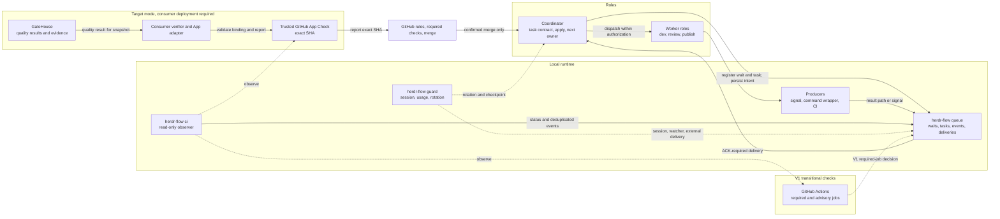
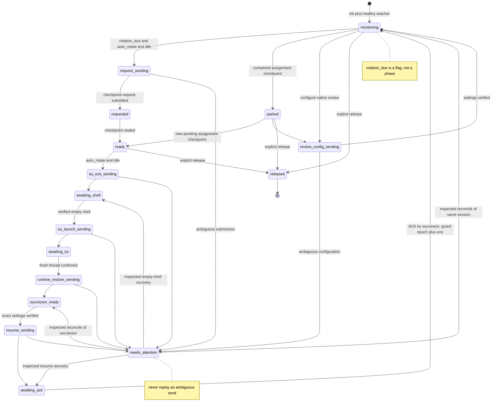
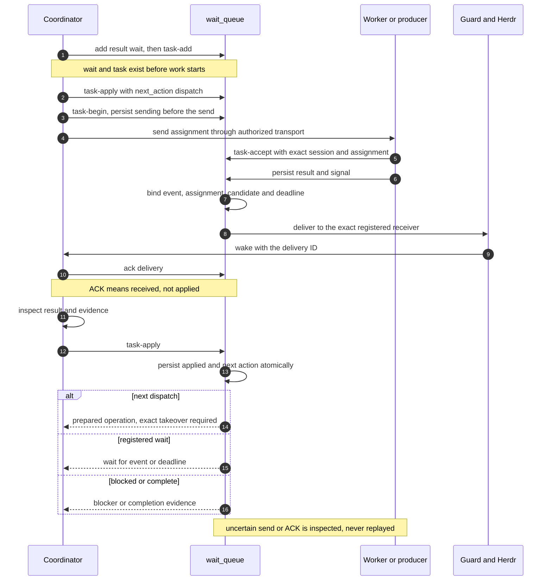
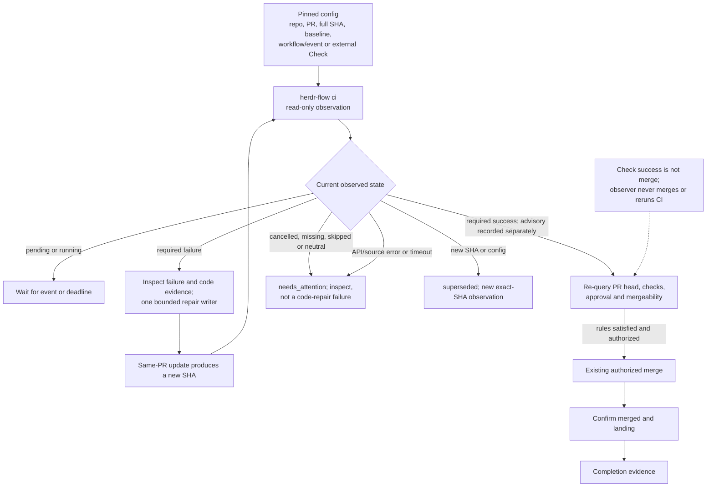
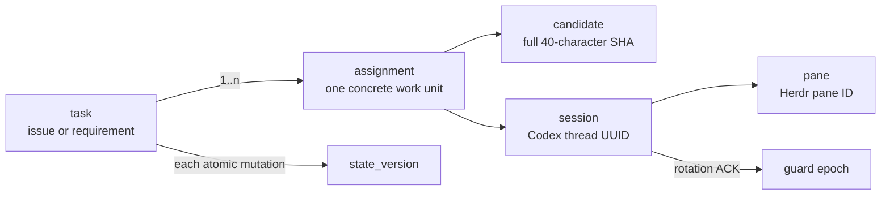

# Architecture and flows

The explicit [GitHub Actions lane policy](actions-batching.md) reuses the bounded
lane with PR-head and merge-main workflow/job checks. The trusted Gate/App
requirements below remain specific to Gate mode; modes are never mixed or
automatically migrated.

This is a maintainability overview of the current source and the explicitly
separate target mode. Implemented paths are drawn as current behavior. Target
paths are labeled and require consumer Gate/App deployment evidence and the
V1/V2 acceptance items in Issues #11/#12/#13. OpenCode 1.19.x (baseline 1.19.3) has a native HTTP session adapter
and a separate process monitoring helper; automatic rotation remains unsupported.
Detailed contracts live in
the linked references; do not copy these diagrams into multiple documents.

## 1. Responsibilities and data flow

`herdr-flow queue` owns durable coordination state; `herdr-flow guard` owns session
identity and rotation; `herdr-flow ci` only reads checks. The coordinator still
decides application and the next owner. See [waiting](waiting.md),
[task progress](task-progress.md), [CI monitoring](ci-monitor.md), and the
[gate client](gate-client.md).

`guard.rs` preserves the public entry points and shared state/lock helpers.
Private modules under `guard/` separate transcript cursors, review journals,
handoff validation, advisor evidence, checkpointing, context observation,
rotation/reconciliation, watcher failures, registration, diagnosis and CLI.
Cross-module helpers have parent-only visibility; persisted fields, lock order
and ambiguous-operation recovery retain their existing contracts.

## 2. Context rotation and recovery

This is a simplified operational view. `reconcile` only applies after an
inspected `needs_attention`; review configuration has its own
`review-reconcile` path. See [context rotation](context-rotation.md) for the
exact checkpoint, runtime and ACK gates.

## 3. Result consumption: received, applied, takeover

The current implementation is described in [task progress](task-progress.md).
PR provenance and same-PR repair use [the PR ledger](pr-ledger.md). Agent
`idle`/`done` is not evidence of application, takeover or completion.

## 4. Checks, observation and merge

### V2 target: one bounded batch at a time

```mermaid
flowchart LR
  A["A confirmed merged"] --> Freeze["Freeze next batch members<br/>and latest base H"]
  Freeze --> Integrate["Integrate each task's own changes"]
  Integrate --> Snapshot["Freeze snapshot S"]
  Snapshot --> Gate["Local full gate<br/>persistent cache"]
  Gate --> Publish["Publish the same S as one PR"]
  Publish --> AppCheck["Trusted App Check for S"]
  AppCheck --> Merge["GitHub required checks and merge"]
  Merge --> Release["Confirm landing, release slot,<br/>prepare next batch"]
```

The target path starts only after the [consumer deployment evidence](gate-client.md#consumer-deployment-evidence)
and V1 runtime evidence are accepted. GateHouse supplies quality results; the
consumer owns its verifier, App/reporting and publication bindings. Upstream
issue closure does not activate this path. Current V1 uses the existing Actions
path and does not claim local-gate or trusted-App integration. See
[CI monitoring](ci-monitor.md), [V2 batching](batching.md), and
[V2 acceptance](v2-acceptance.md).

## 5. Identity and epoch legend

| Identifier | Scope | Changes when | Not the same as |
| --- | --- | --- | --- |
| `task` | Issue/requirement | New requirement | Assignment or PR |
| task `epoch` | Assignment ownership | Ownership changes, not each status update | Guard epoch or `state_version` |
| `state_version` | One queue task record | Each accepted atomic mutation | Session generation |
| guard `epoch` | One registered session generation | Rotation ACK increments it | Task epoch or V2 batch ID |
| `pane` | Herdr layout | Pane move/replace | Codex session |
| `session` | Codex thread | New session/rotation | Pane or assignment |
| `assignment` | One dispatched work unit | New successor or recovery contract | Task, PR or batch |
| `candidate` | Exact source snapshot | Content/baseline changes | Branch name |
| batch ID | V2 bounded delivery | New batch intake | PR number or task epoch |
| `rotation_due` | Boolean guard flag | Threshold observation | A phase name |

Assignment IDs are never reused after completion. A fresh session does not
invalidate unchanged evidence or existing authorization; a changed candidate or
baseline does.

## 6. Local trust and safety boundaries

These controls protect the local runtime; they are not a substitute for the
repository's authorization, review or merge rules.

- **State and handoff files:** writes use an atomic replacement with mode 0600
  and an fsync, create missing parents as 0700, and reject a symlinked parent.
  Configuration, state and evidence stay outside the checkout.
- **Commands and workspaces:** the Codex Herdr client rejects shell metacharacters
  in arguments; shell-interpolated paths reject them too. Batch Git allows only
  an explicit command whitelist, rejects global config overrides, uses an
  absolute existing cwd and a timeout, and redacts credentials/user paths/tokens
  from diagnostics. Workspace overlap checks resolve paths before comparison.
- **Transport:** the app-server Unix socket must be a socket owned by the current
  user and must not be world-writable. Both RPC and TUI also authenticate the
  connected peer with Linux `SO_PEERCRED` before forwarding handshake or business
  data; query failure or a different effective UID closes the connection. This
  protects against cross-UID endpoint substitution, not malicious same-UID
  processes. JSON-RPC messages and headers have size limits, and JSON nesting is
  bounded.
- **External observations:** external Checks bind an exact App, name,
  `external_id`, full SHA and base. The inventory is capped at 32 entries, and a
  commit with more than 1000 Check suites is refused rather than inferred green.
- **Producer trust:** generic signals, handoff files and `producer_identity`
  metadata rely on local filesystem trust. The queue does not authenticate an
  OpenCode process; the coordinator verifies the producer, session/model and
  evidence independently.
- **Platform:** the Codex guard requires Linux `/proc`, Unix domain sockets and
  `flock`. Missing capabilities fail closed instead of degrading silently.

See [CI monitoring](ci-monitor.md), [wait queue](waiting.md) and
[OpenCode integration](opencode-v2.md) for the operational contracts.

## Source map

| Flow | Current source | Separate acceptance |
| --- | --- | --- |
| Shared queue/task state shapes | `src/model.rs` | static only; runtime validators remain authoritative |
| Result application and takeover | `src/progress.rs`, `herdr-flow queue`, `src/queue/cli.rs` | #11, #15 evidence |
| Context guard and rotation | `herdr-flow guard` | #13 |
| Native Codex transport, TUI lifecycle and runtime binding | `src/herdr.rs`, `src/codex/rpc.rs`, `herdr-flow tui` | #13 |
| OpenCode 1.19.x (baseline 1.19.3) | `src/opencode.rs`, `src/opencode/` | native dispatch/result return; no automatic rotation |
| CI and external Check observation | `herdr-flow ci`, `src/ci/checks.rs` | #11 external Checks |
| PR provenance and same-PR repair | `src/pr.rs` | #11 |
| Read-only task and delivery metrics | `src/metrics.rs`, `src/queue/cli.rs` | #6 |
| V2 bounded batches | `src/batch/lane.rs`, `src/batch/git.rs`, `src/batch/validation.rs` | #12; consumer deployment acceptance |
| Trusted gate client boundary | `src/batch/gate.rs` | consumer verifier contract and deployment acceptance |
| Watcher supervision and command wrapper | `src/watch_service.rs`, `src/queue/command.rs` | internal |
| Shared errors, logging and CRAP gate | `src/error.rs`, `src/logging.rs`, `cargo run -- crap` | CI/local gate |

Missing or unsupported capabilities are reported as gaps; they are not drawn as
successful transitions.
