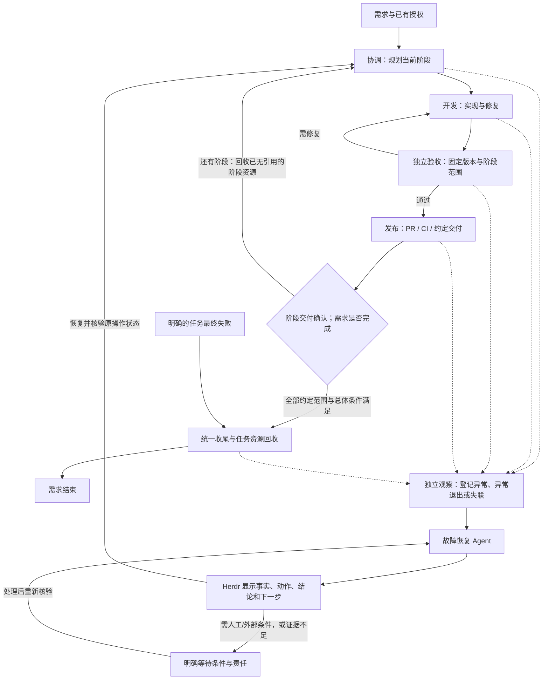
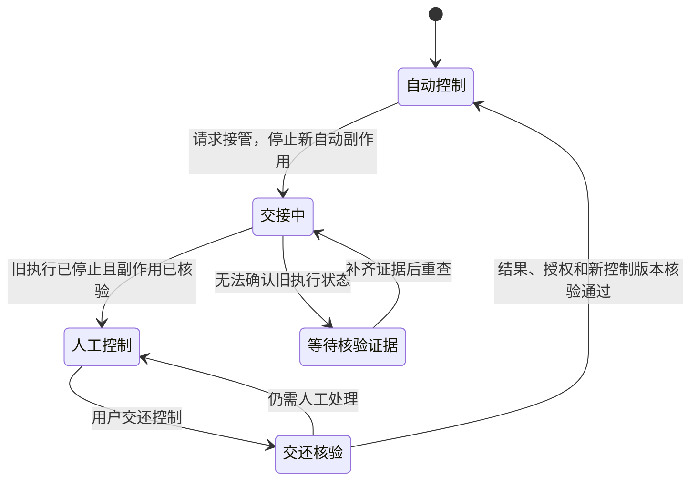

# Agent 长任务与故障恢复方案草案

## 2026-10-27 已确认流程与 Issue 对齐（当前执行依据）

本节同步本轮已确认的流程及 Issue 更新，优先于下方历史建议、旧验收矩阵和
“尚待确认／尚未批准”的当时表述。方向已确认不等于代码已经实现；本次只提交
已完成的方案与记录，后续开发由相应 Issue 跟踪。历史内容与失败结果原样保留。

目标是让正常任务持续推进，支持一个需求跨多个阶段、PR 和会话，也支持一次开发、
编译或测试持续数小时。出现异常时，程序记录现场并交给独立故障恢复 Agent，
由它诊断、处理、给出结果。程序不需要预先穷举每种故障的全部分支。

### 角色与模型

| 角色 | 已确认职责 |
| --- | --- |
| 协调 Agent | 维护需求与阶段进度，拆分阶段/PR，派发开发与验收，接收发布/恢复结果并推进到约定终点 |
| 开发 Agent | 实现、测试和修复业务成果，可持续多次提交 |
| 独立验收 Agent | 在独立会话与固定候选快照上判断指定范围；阶段通过不代替总体验收 |
| 发布 Agent | 在已有授权和项目约定内处理 PR、CI、合并/交付接力，将实际结果交还协调者 |
| 故障恢复 Agent | 读取真实现场，在已有授权内诊断与处理，核验恢复结果或明确交给人工；不改写验收与交付事实 |

五类角色的模型与推理强度分别配置，并在 Herdr 原生 Codex TUI 中可定位、查看和
介入。复用既有角色配置，包括 `roles.publish`，补充独立恢复角色；不静默继承或
更换模型。只支持 Codex，OpenCode 明确不支持。登录、provider、订阅、计费和代理
由既有 Codex 管理，不复制令牌、不另造凭据库、不自动切换账户或计费路径。

### 执行、异常和人工交接

- 基本观察和触发独立于可能停止的 task watcher/broker；按异常事件唤醒恢复
  Agent，同一事件去重，不持续使用模型轮询。卡住的程序未必退出，仍需基本观察，
  但时间经过或没有输出不构成业务失败。
- 每次处理给出可见结论：已恢复可继续；已定位但需要外部条件/人工；或证据不足
  并说明下一步。恢复 Agent 或共享模型服务不可用时保留现场、暴露恢复不可用，
  不静默停止、不无限派生恢复角色。所有展示/通知通道失效时不能承诺实时通知。
- 正常需求默认不设强制业务总时限；明确的业务截止时间由任务约定。通信等待、
  界面就绪、观察异常、人工等待与业务终态分开，不以固定 600 秒或累计调用次数
  耗尽判定正常任务失败。累计记录需要任务内检查点与安全回收，资源压力可见并
  可接续，不把所有容量改成无限，也不丢弃未决操作和去重依据。
- 查看、讨论和普通指令不自动等于全面接管。人工需要修改对象时，先核验旧执行
  并交接对应写入权；处理后由恢复 Agent 核实状态，再交还协调者。其他独立资源
  上的并行不因此全部停止。未知发送、Git 或交付结果先查询，不能凭超时重放。
- 每阶段有明确范围、固定候选验收和交付事实；已无引用的阶段资源及时回收，
  后续仍需要的需求状态保留。总体条件满足才完成需求；明确最终失败同样统一
  收尾。等待人工、中间失败和结果未知不触发提前销毁。
- 保留已有授权、资源归属、同对象写入权、独立验收和防重复交付。最终清理覆盖
  恢复角色、窗格、会话、阶段工作区及临时状态；不得改删用户登录、配置和共享
  资产，不把任务残留改称“上游数据”，不建永久任务证据库。

### 实现状态与必要验证

[PR #142](https://github.com/musutrade/herdr-flow-rust/pull/142) 和
[PR #144](https://github.com/musutrade/herdr-flow-rust/pull/144) 仍为未合并草稿。
上游配置解耦、queue-control、独立 reviewer 快照、角色模型选择、本地单任务
闭环及原生 TUI 已有各自开发分支证据，详见[原生 TUI 说明](../native-tui.md)。
Recovery Agent、独立发布接续、多阶段交付和人工写入权交接尚未实现。

最新分工和顺序：

1. [#130](https://github.com/musutrade/herdr-flow-rust/issues/130) 先接通异常出口、
   独立恢复角色与结果，修正正常长任务的错误超时和累计容量语义。
2. [#130](https://github.com/musutrade/herdr-flow-rust/issues/130) 与
   [#112](https://github.com/musutrade/herdr-flow-rust/issues/112) 接上阶段/PR、发布、
   Herdr 和人工交接，复用既有任务、CI、回收及原生 TUI 能力。
3. [#38](https://github.com/musutrade/herdr-flow-rust/issues/38) 验证异常到结果、接续
   或人工处理的基本通路，以及阶段交付、回收和具体改动的必要回归；
   [#32](https://github.com/musutrade/herdr-flow-rust/issues/32) 汇总整个流程。

不再把连续至少 20 条、穷尽故障矩阵、所有数小时任务先跑完或预先校准所有阈值
作为通用交付前提。既有适用证据复用，旧失败不追认为通过；历史 Git 10 秒回收
夹具超时的未明根因仍须按具体线索定位。Rust 1.85.0 门槛不重新引入，现行项目
质量检查继续适用。旧 V1→Gate/App→V2 顺序不再是本流程通用前置，实际选用的
发布策略仍遵守其约定。集成继续使用独立队列，不切换全局入口、旧 watcher 或旧队列。

---

## 2026-10-27 最新目标：异常有人接住，并给出处理结果（优先适用）

用户明确，故障边界无法穷举。系统应让正常任务持续推进；任务出问题、Agent
异常停下或程序暴露故障后，由独立故障恢复 Agent 根据现场证据处理并给出结果。
本条优先于下文把完整故障矩阵、所有长任务场景实测或阈值校准列为方案前置条件
的建议。历史源码评估保留；恢复角色与独立触发通路仍未实现，本轮只更新方案。

职责收敛为一条通路：

`执行异常或失联 → 程序记录现场并触发恢复 Agent → Agent 排查与处理 → Herdr 显示结果 → 接续任务或明确交给人工`

- Rust 提供基本的异常出口、执行状态与身份观察、故障登记和独立触发。正常完成、
  正常等待、异常退出和无法观察应有明确表示。卡住或失联未必有退出码，因此仍需
  一个独立观察入口；它负责提示和触发，不能仅凭时间经过便判定业务失败。
- 故障恢复 Agent 在故障发生后读取真实日志、任务状态、进程和原操作记录，判断
  原因并在已有授权内处理。具体问题由 Agent 现场分析，不要求程序事先枚举每种
  网络抖动、Git 卡住、模型失败或环境问题的完整分支。
- 每次处理必须留下用户可见的结论：已恢复并可继续；已定位但需要外部条件或人工
  操作；或者证据不足、暂时无法判断。结论说明已知事实、已做动作、当前状态和下一步。
  给出结果不等于承诺总能自动修复，也不能将未知包装成确定原因。
- 恢复 Agent 的模型独立配置，并在 Herdr 可见。若恢复 Agent 或共享模型服务也
  不可用，程序保留现场并暴露“恢复处理不可用”，等待可用条件或人工处理；不能
  静默消失，也不能无限派生更多恢复 Agent。外部告警路径自身的可用范围需如实说明。
- 已有授权、资源归属、原操作状态核验、保护登录配置和防重复交付继续适用。
  正常开发不应被未经需求约定的固定总时限或累计调用次数判为失败。现有多 PR
  单交付结构等具体实现缺口仍需改动，不能靠恢复 Agent 绕过正确性检查。

验证聚焦上述基本通路以及具体改动所需的回归：能发现并记录异常、能交给恢复
Agent、能展示处理结果，并能按结果安全接续或等待人工。不再把穷尽故障组合
当成能够交付故障处理能力的前提，不为尚未发生的每一种边界持续增设限制。

## 2026-10-27 最新评估：多 PR 需求与长时间开发（优先适用）

用户指出现有限制缺少真实场景实证，也难以在需求开始前预估消耗。本轮按
`fix/native-tui-attachment` / `2f0d2b2` 复核源码；以下为静态路径评估，未进行
数小时真实任务验收，也未修改代码或现有阈值。小任务和协议夹具的通过，只能证明
其覆盖的行为；尚不能证明固定时限、累计次数和单次交付结构适合以下两个场景。

**纠正先前时间说明：** 600 秒不仅出现在真实验收程序中。
`src/task_runtime/native.rs:592` 还把 worker 的 turn 记录截止时间写成当前时间加
600 秒；`:752` 的收集逻辑会把超过该时间且仍在运行的 turn 标成 `timed_out`。
该分支不发送中断，不将其直接改成业务最终失败，之后仍可能收集到完成结果；
但它会把正常长执行标成超时。它与队列等待期限、结果应用期限和测试预算互相独立。

场景 A：一个需求分多次开发、评审、提交 PR 和交付。

| 限制 | 实际影响 | 源码依据（上述开发分支） |
| --- | --- | --- |
| 自动主线只有本地 Git 交付 | 远端 PR、CI 和多 PR 接续没有接入这条完整链路；旧 PR／批次模块不是这项场景的完成证据 | `src/task_runtime/native/receiver/control/continuation.rs:197` |
| 一个环境只有一份正式交付意图 | `delivery prepare` 冻结父需求为 delivering；原环境不能直接承担阶段交付一、阶段交付二的连续循环 | `src/delivery/mod.rs:74`、`:171`，`src/progress/lineage.rs:94` |
| 当前验收绑定父需求和一个候选 | 阶段 PR 与整个需求的验收范围尚需明确；第一阶段通过不能直接宣布整个需求完成 | `src/progress/lineage.rs:237`，`src/progress/acceptance/validation.rs` |
| 控制请求累计最多 64 条、日志最多 1 MiB | inspect、ACK、apply、lineage、run 等按不同请求累计；多轮修复或阶段推进可能达到限制。普通 Git 提交和开发者工具调用不等于一条该控制请求 | `src/task_runtime/native/receiver/control.rs:125`，`src/task_runtime/broker/tools.rs:4` |
| 长会话及其他累计容量边界 | broker 的 turns、pending 各校验最多 64 条；后继派发协议每任务最多 128 个 operation；需求修订最多 128 次、产物登记最多 256 条。适用范围不同，不能混成 PR 数量上限 | `src/task_runtime/broker.rs:213`，`src/progress.rs:938`，`src/progress/lineage.rs:172`、`:208` |
| Flow 上下文监测、安全换班未接通 | 新协调者明确返回两项能力为 false，无法据此承诺长流程中的受管交接和恢复 | `src/task_runtime/native/receiver/active.rs:105` |
| 回收以父任务生命周期为边界 | 子活动完成不终结父 Owner；需要阶段资源释放与需求继续之间的明确契约，不能提前清除仍需接续的需求状态 | `references/task-lifecycle.md:39`，`references/independent-acceptance.md:120` |

场景 B：一次开发、编译或测试本身持续数小时。

| 限制 | 实际影响 | 源码依据（上述开发分支） |
| --- | --- | --- |
| worker 固定 600 秒截止记录 | 正常长 turn 可被标成 timed_out；未因此自动终止 Agent，但状态语义已经错误 | `src/task_runtime/native.rs:585`、`:752` |
| 活动等待必须指定 1 秒到 7 天的期限 | 从登记等待时开始计时，未按正常进展自动续期；没有无总期限选项。到期可生成 timeout 事件，不能把它当原执行已经结束 | `src/queue/mod.rs:470`、`:498`、`:1273` |
| 失败与未知结果的恢复未闭环 | 控制／收集链路部分非 StateBusy 错误退出 watcher；共享 socket 身份变化被拒绝。长运行中遇到通信故障或服务重启时不能承诺自动接续 | `src/queue/cli.rs:944`，`src/task_runtime/upstream.rs:28` |
| 本地 Git 交付同步等待且无执行时限 | push 或 hook 卡住可能阻塞推进；delivery execute 还持有队列锁，影响同队列控制。无需网络也可能发生 | `src/delivery/local.rs:102`，`src/delivery/mod.rs:195` |
| 人工等待和恢复计时缺少完整分工 | 已能展示、输入和透传审批，但尚无完整的人工接手、等待期间计时与交还流程 | `references/native-tui.md` |

需要区分的其他数字：结果应用默认 600 秒从结果入队后计算，只产生相应停滞事件；
后继接手默认 600 秒也不是开发时间上限。原生 TUI 的 20 秒只用于界面就绪检查，
RPC 与 Git 查询的短期限只用于各自的调用。单次持续工作不会因为时间经过就消耗
64 条协调控制请求，但反复控制交互、恢复尝试与长会话会涉及各自的累计边界。
旧独立 CI observer 默认观察 6 小时、可设 1 秒到 7 天，超期会写 timeout 并退出；
它目前拒绝作为新隔离任务的专属 watcher，不能当成已经接入主线的长任务能力。

后续设计建议，以实际需求场景为验收依据：

1. 将需求生命周期、阶段交付和执行会话分开表达。需求可跨多个 PR 和会话；每阶段
   有明确验收范围、交付事实和资源回收，全部约定阶段与总体条件满足才完成需求。
   沿用已有任务与 PR 契约，不靠重建无关联任务来绕过计数。
2. 正常开发默认不设强制业务总期限；明确的业务截止时间由任务指定。通信期限、
   通道健康、无进展提醒、等待人工和自动恢复预算分别表达。超时不证明失败或停止。
3. 累计记录改为可持续推进的检查点与回收策略，资源上限约束当前占用、并发和单次
   消息；保留未决操作与去重依据。触及资源压力应提前可见，并支持暂停／背压／接续，
   不将次数耗尽直接转成需求失败，也不直接把所有上限改成无限。
4. 故障恢复 Agent 承担诊断和恢复推进，Rust 承担事实观察、归属校验与执行。增加该
   角色本身不能解决单次交付结构、累计容量或错误计时；这些底层契约需一并调整。
5. 保留已有授权、资源归属、单写入者、精确候选验收和防重复交付约束。验证应覆盖
   多 PR 接续、真实长开发、长时间等待人工、网络抖动、控制进程恢复及阶段回收；
   各阈值注明用途、依据、可配置范围、触发后行为和证据，尚未验证的值明确标注。

## 2026-10-27 最新讨论：独立故障恢复 Agent（优先适用，尚未实现）

用户提出将“阻塞后核实原因、推进恢复、必要时协调人工介入”交给独立 Agent。
本方案据此增加故障恢复角色（Recovery Agent），沿用角色模型分别配置、在 Herdr
可见、复用现有 Codex 登录与服务、任务资源登记回收的要求。当前代码尚无该角色。
本节只记录职责方向；下面的触发、执行和控制权机制属于配套建议，仍需继续讨论。

原生 TUI 接入已在开发分支 `fix/native-tui-attachment` / `2f0d2b2` 验证；它提供
原会话的查看与输入，不代表人工接管、异常告警或故障恢复闭环已经完成。下文保留
早期接入状态与评审历史，当前接入状态以[最新验证记录](herdr-python-rust-verification.md)为准。

| 承担者 | 职责 |
| --- | --- |
| Rust 监测与执行程序 | 核验进程、心跳、会话与操作事实，记录和去重异常，触发恢复 Agent；对恢复动作检查归属、已有授权和当前状态，并保存实际执行结果 |
| 故障恢复 Agent | 读取相关证据，区分业务问题、运行故障、结果未知和等待用户；在既定恢复权限内推进处理，核验恢复结果，必要时向用户说明阻塞、已做检查和所需介入 |
| 协调、开发、验收 Agent | 继续负责业务任务、代码修复与独立验收；恢复结束后按核验过的原任务状态接续，验收结论和已有交付事实保持其原有权威 |
| 用户 | 处理恢复范围之外的决策、需求澄清和必须由本人完成的账户等操作；人工接手与交还控制需要明确记录 |

建议的运行边界：

1. 异常触发和基础告警应独立于被监测任务的 watcher、broker 和进程组，复用已有
   `watch_service::health` 等事实检查，不能让停止的执行者负责唤醒自己的恢复者。
   独立触发路径尚需实现；不据此宣称已有全局监督或可靠告警。
2. 按异常事件唤醒恢复 Agent；同一故障去重，一次只允许一个恢复控制者。基础监测
   由程序持续进行，模型只在诊断和恢复推进时运行。恢复预算与正常长任务时长分开。
3. 修改或接续执行前先核验旧 turn、工具、Git 进程和副作用状态，并完成必要的控制权
   交接。结果未知时先查询；超时和无响应本身不能授权重发任务或重复交付。
4. 恢复 Agent 的模型和推理强度独立配置，复用现有 Codex 服务。若共享服务或模型
   网络整体不可用，它也可能无法运行；故障状态持久化与人工告警必须有不依赖模型
   的路径。恢复 Agent 自身失败时按有限策略处理并升级人工，不递归创建更多恢复 Agent。
5. Herdr 提供恢复 Agent 的独立可定位入口，并关联原任务和原 Agent 会话。呈现异常
   证据、已执行动作、当前等待条件和需要用户决定的事项；原会话的人工输入仍须经过
   写入权交接。恢复成功必须核实结果，再把控制交还协调者。
6. 恢复动作由程序检查和执行，具体允许的动作与预算仍待确定。该角色不获得新增
   登录、复制认证、改代理、切换计费路径或擅自重启共享服务的权限。它自己的会话、
   窗格、工作区和证据也须登记归属并回收；任务回收受阻不能通过改称上游数据解决。

状态：待讨论，尚未批准实施。初稿日期：2026-10-26；项目评审修订：2026-10-27。
背景、源码基线和来源见[调研备忘](agent-reliability-research.md)。

本次已确认的要求优先适用：协调、开发、评审 Agent 必须在 Herdr 可见，并能在
需要时介入原任务。只有后台运行或只读日志不算接入完成。其余策略仍为设计建议，
评审轮只更新文档。后续能力验证使用独立试验工作树和一次性任务，不改变生产
入口、账户、配置或既有队列；结果见[Python/Rust 对照与验证记录](herdr-python-rust-verification.md)。

**2026-10-27 路线纠正，优先适用：** 按用户要求重新核对 Python 原项目和 Herdr
skill 后，首选复用已经移植的 `herdr-flow tui` 原生 Codex 窗口与协议桥，连接同一
上游、同一任务会话。暂停扩展自制交互面板。Rust 迁移应保留原有可见 Agent 操作
方式，再接上新增的任务隔离、独立评审和回收能力；不能因后台测试通过就改变
用户工作流。历史面板建议保留在下文，并由本条取代其优先级。

基础原生交互已验证通过，尚不等于独立任务集成通过。最新验证还定位到共享
daemon 的 Herdr hook 错误继承窗口归属，以及新任务目录信任／入场限制。
先解决这些接入边界，再推进完整任务；输入历史与工作区文件回收应分项记录。

建议先验证 Herdr 到原会话的交互通路，同时明确任务、操作、执行器和清理的权限，
再实现长任务和恢复策略。可见性与人工操作不能留到最后作为附加界面。
目标是让几个小时的正常工作持续执行，让故障能够被解释、恢复或交给用户处理，
同时避免重复派发、重复交付和误删资源。

## 一 约束和本轮范围

沿用既有认证归上游、角色模型独立配置、只支持 Codex、任务资源精确归属和独立
验收队列等边界。不更改旧 watcher、旧队列或全局入口。
本草案不授权改变计费、代理、登录，也不默认允许 Agent 获得命令网络权限。

以下状态名称是设计语言，不要求立即新增数据库、表或平行日志。
实现时先映射到已有 queue / task / turn / operation / cleanup 记录；
只有表达能力确实不足才扩展字段，采用显式版本，旧记录不得隐式升级。

本方案审计的是 PR #142 开发基线 `e036bfc2`，不是当前保存文件的 `main`。
以下标为“现有”的能力只指该基线；“拟补充”和状态图均不表示已实现。
2026-10-27 评审发现及源码证据见调研备忘 R1–R7。

## 二 分开表达四类状态

| 层次 | 建议表达 | 解决的问题 |
| --- | --- | --- |
| 任务 | 进行中、等待外部条件、待人工、暂停中、已暂停、取消中、业务成功、业务最终失败、已取消 | 请求出错或执行器离线不会自动改变业务结论 |
| 执行器 | 正常、失联、退出、待恢复、待审批 | “进程活着”与“任务有进展”分开；界面不能用 alive 代替正常 |
| 操作 | 已准备、发送中、已接纳、执行中、成功、确定失败、结果未知 | 保存 Agent turn、Git push 等有副作用操作的真实确定程度 |
| 清理 | 未开始、待清理、清理中、受阻、已完成 | 业务结束后清理失败不会反向篡改业务结果；清理完成前不得显示“全部完成” |

恢复失败通常先进入待人工或等待条件，不自动转为业务最终失败。
每次状态变化都要有事件来源、时间、原因和操作者；推断不能覆盖原始事实。

### 映射到项目现有实现

| 契约 | 现有落点 | 拟补充／必须验证的差额 |
| --- | --- | --- |
| 任务控制 | `src/progress.rs` 的 `phase`、`control`、`state_version` 与任务绑定 | `paused` 只是流程标志；补充暂停请求、执行静止证据、控制权交接。现有 `resume` 注册恢复等待，不能当 Codex 接续使用 |
| 操作事实 | `progress` 的 prepare/send/accept、`native.rs` 的 `turn.json`、`broker` 和 `delivery/local.rs` 的意图记录 | 复用既有逻辑操作身份，补充尝试、错误来源、未知结果核验；不能另造一份可独立推进任务的日志 |
| 执行器归属 | `Owner` 的 queue/task/epoch/instance、runtime 记录、`lifecycle.rs` 的 permit | 文件锁约束协作调用方，不能阻止直接 PTY 输入或已在上游运行的工具；控制权版本必须在实际写入入口检查 |
| Herdr | `src/herdr.rs`、`src/codex/tui.rs` 已有 pane/terminal/session 核验；native receiver 是另一条路径 | 新流程需绑定角色入口、交互和观察，不能把旧适配器已有 TUI 支持直接等同于 queue-tool-v2 已可用 |
| 人工审批 | broker 记录请求，native collector 可识别 blocked | 拟增加按原请求回应和中断能力。现有 `tool/respond` 只用于动态工具结果，不是通用审批 API |
| 评审 | `task_runtime/review.rs`、`task_env/review.rs` 的独立 candidate 快照 | 人工修改后形成新 candidate，重新评审；不能原地修改旧快照或改写旧评审绑定 |
| 终态与清理 | `final_outcome`、`cleanup_obligation`、`queue/finalization/`、`task_env/cleanup/terminal/` | 当前终态只接受 success/failure。取消语义必须显式扩展并贯穿清理校验，不能把 cancelled 强行转换为 failure |

拟采用“取消请求”和“取消完成”分离的契约：请求先关闭新的自动副作用入口；
核验运行中的 turn、工具和交付之后，才写入终态。新协议显式支持取消结果，旧版
读取者遇到新版本应拒绝写入。已确认的交付保持其事实，不因取消请求回滚或抹去；
若任务完成条件已经满足，保留成功并记录取消未生效。交付仍未知时不得宣布取消
完成或启动破坏性清理。此变更需连同所有终态消费者验收，不只改 UI 枚举。

## 三 统一证据和操作契约

沿用 Owner 和 task/epoch/instance，增加或复用以下概念：

- 逻辑操作 ID：一次明确授权的动作；多次传输尝试仍属于同一逻辑操作。
- 尝试 ID：某次发送或执行尝试。记录开始、结束、结果和失败类别。
- 上游身份：session、turn、工具调用 ID；本地执行记录 PID 与启动身份。
- 错误证据：来源、原始错误码、经过脱敏的消息、关联身份、是否明确未发送，
  是否可能已产生副作用。保留“未知”，不把文本匹配当作可靠事实。
- 策略快照：重试和提醒策略版本、角色模型选择、授权范围；恢复时不得悄悄改配置。

连接重建后不得假设请求 ID 仍全局唯一。审批和动态请求还需关联连接代次、
session / turn 及原请求内容；旧请求不能被新连接上恰好相同的 ID 接收。
会话接续若产生新 turn，保留旧 turn 和副作用证据，明确记录前后关系。

每种可恢复操作必须提供四个适配能力：

| 能力 | 契约 |
| --- | --- |
| 发起 | 先持久化意图；明确哪些阶段可能已产生副作用 |
| 观察 | 返回已执行、未执行、仍执行或未知，并附可核验证据 |
| 恢复 | 明确是重新查询、恢复传输、接续会话还是重新执行；不能统称 retry |
| 取消 | 明确能否中断及如何确认已停止；取消请求已发送不等于取消完成 |

副作用发生后、成功回执持久化前崩溃，是必须测试的窗口。
若上游既没有幂等键也不能核验原操作，应进入待人工，不能承诺 exactly-once。

## 四 故障处理矩阵 建议规则

所有行先通过同一个判断顺序：核验原操作身份和是否仍在执行 → 判断接纳／副作用
是否确定 → 分类错误 → 应用恢复预算。429、超时或“网络错误”本身均不提供重跑授权。

| 情况 | 建议动作 | 禁止或限制 |
| --- | --- | --- |
| 明确未发送的瞬时连接失败 | 在原逻辑操作内按预算退避重试 | 不创建新任务；不能把“没有收到响应”当成“未发送” |
| 已发送但回执丢失 | 按原身份查询；确认结果后继续 | 不重复 turn/start，不重新启动第二个写入者 |
| 上游 turn 明确因临时错误终止 | 核验工具、文件、提交和交付状态；确认旧执行已结束后，从同一会话明确接续 | 新 turn 是恢复尝试，不是假装旧 turn 从断点继续；缺乏错误分类证据时待人工 |
| 429、服务繁忙或临时不可用 | 先核验原操作是否接纳和已产生的副作用；满足恢复前置条件后，尊重可用的 Retry-After 并按预算退避 | 不将上游内部某次请求失败解释成整个 Agent turn 未执行；不静默切换模型、provider 或计费路径 |
| 认证、权限、额度或配置错误 | 保留任务，报告具体原因，等待用户修复 | 不反复登录、不替换凭据、不持续快速重试 |
| 正常长时间推理、编译、测试 | 继续运行；显示最近可见进展及未知部分 | 不用固定 10 分钟或“无日志”判失败 |
| Git 读取／下载明确失败 | 先确认旧进程已结束，再按操作策略重试 | 检查 clone 等命令留下的部分目录；不是所有读取型命令都可原样重跑 |
| Git push 结果未知 | 查询远端引用并比较预期提交；查询失败仍是未知 | 不重复 push、不重置远端、不把查询超时当未交付 |
| Git 或测试疑似卡住 | 收集进程、连接、输出和锁状态，提醒或进入待人工 | 不删除锁文件、不强杀未知进程、不立即重跑 |
| watcher／broker 崩溃 | 验证旧 Owner、进程退出和锁，再恢复观察；控制权需另行核验 | 不重新派发已有 Agent；健康期限到期或锁释放不能证明上游旧 turn／工具已停止 |
| 共享 app-server 重启或 socket 身份变化 | 先保留旧记录，按明确的重新绑定协议核验端点归属、原会话与授权配置；不能确认时待人工 | 当前实现拒绝身份变化，不能覆盖旧 socket 身份绕过保护；不重启或清理共享服务 |
| 等待审批或用户输入 | 持久等待并通知；回应关联原请求 | 不自动同意，不将等待人工累计为网络重试失败 |
| 暂停／用户取消 | 区分停止新派发与停止当前执行；确认当前副作用状态后进入暂停或终态 | UI 点击后不能立即显示“已停止”；取消过程中也可能发现交付已经完成 |
| 清理失败 | 保留清理义务，按归属核验继续或请求人工处理 | 不改写业务结果，不删除共享配置来完成指标 |

网络错误和用户拒绝审批不得按业务验收失败处理；编译／测试不通过也不自动是
任务最终失败，可以进入原授权范围内的修复循环，但修复预算要单独记录。

Git 边界分开实施：当前自动交付器只支持本地目标；Agent 执行的 fetch/clone/push
属于工具操作，未来受管的远端交付需单独适配和授权。远端引用核验规则不能让
`delivery/local.rs` 默默接受网络目标，也不能借恢复过程打开现有命令网络限制。

## 五 时间 重试和进展策略

建议分开配置，不再使用一个固定期限决定整个任务命运：

1. 单次通信期限：限制连接／响应等待；到期只更新该操作的确定程度。
2. 执行器健康期限：判断观察通道是否失联；不代表业务操作已停止。
3. 无可见进展提醒：表示需要诊断，不是自动失败条件；记录观察能力是否缺失。
4. 自动恢复预算：限制恢复尝试次数与累计恢复时间；正常执行时间不算恢复预算。
5. 业务任务期限：建议默认不设强制总期限；确有业务截止时间时，由任务显式指定。
6. 测试保护期限：限制测试设施占用；达到期限记“验收未完成”，进入明确的
   测试收尾或保留现场流程，不伪造业务终态，不遗留无人管理的进程。

退避、重试次数、提醒间隔和恢复预算的具体数值暂不写死，后续结合任务目标与采样
提出默认配置并审定；这些数值不能决定是否支持正常长任务。
预算耗尽的建议动作是挂起并通知，而非自动最终失败或清场。
进程心跳、模型可见输出、工具输出、Git／测试结果是不同进展信号。
自动发送心跳不能掩盖一个永久挂起的操作；没有输出也不能证明没有工作。

避免重试叠加：明确上游 SDK、Agent、操作适配器、队列各自能重试什么。
同一副作用只允许一个层次负责重新执行；其他层次只能查询或恢复传输。
无法观察上游内部重试次数时，应在界面标注未知，不虚构全局计数。

### 不能遗漏的现有边界

| 现有机制 | 调整方向与验证 |
| --- | --- |
| worker turn 的固定 600 秒 | 替换为明确的观察／提醒策略和可选业务截止时间；超时观察不授权重发原 turn |
| queue wait 的 1 秒至 7 天期限 | 长任务不能仅修改 turn 期限。为新协议设计可持续观察，保留已超时的历史 wait；续观察或重新绑定须由原任务授权，晚到结果只能按原绑定收集一次 |
| apply/accept 的默认 600 秒 | 保持“结果未应用／后继未接纳”的监督含义，单独配置；不能随业务总期限一起删除，也不能自动转为业务失败 |
| 工具／控制日志 64 条、1 MiB 等上限 | 达界前可见提醒和受控停发；设计分段记录／完成摘要及去重索引。未决请求与未知结果不能轮换丢弃，旧请求重放仍须被拒绝。单纯扩大或取消上限不是长任务支持 |
| broker RPC 与 Git 命令等待 | 按操作分类设置观察、通信和中断策略；本地交付等待进程不返回时，要能报告并核验，不靠另一个任务总超时兜底 |

持续数小时但调用很少，与持续产生大量工具调用，是两个不同验收维度。
上线策略还需固定具体预算和提醒数值，随任务保存策略版本；本轮不凭已有测试
600 秒反推生产 SLA，也不要求用户先提供所有工程参数才能验证交互通路。

## 六 Herdr 可见性与人工接管

### 用户可见的结果

Herdr 是本流程必须提供的操作入口。建议一个任务入口展示协调、开发、评审角色，
每个角色可定位到独立 pane 或角色详情；尚未启动的角色明确显示“未启动”。
在首次派发副作用前完成入口归属登记和可用性核验。用户不需要查后台 PID 或手工
寻找 session 才能介入；断线后入口应可重新打开，并准确显示当前可用操作。

| 用户看到的内容 | 必须能做的事 |
| --- | --- |
| 任务、角色、模型与推理配置、工作区、阶段及当前控制者 | 定位原角色，查看当前任务上下文与近期可见输出；模型标明是哪个角色的固定选择 |
| 最近进展与最后成功观察时间、失联／退出／未知的区别 | 判断是长时间工作还是观察已中断；展开原始错误证据，不能只给“运行中”绿灯 |
| 审批、输入请求、恢复受阻的原因和所需动作 | 回应对应请求、补充说明或请求接管；错误原因未知时直说未知 |
| 当前恢复尝试、预算、下次动作、取消与清理状态 | 请求暂停、取消、进入人工控制、交还自动流程；操作未确认时显示待确认，不能显示已完成 |

后台仍使用原 queue / task / runtime 事实。界面是投影和操作客户端，不建立第二套
任务权威，不以终端文本、Herdr 的 idle/blocked 标记代替业务结论。
流式输出可以有界截取并标明缺口；审批、控制变更、终态和副作用证据必须持久化。

### 首选验证路线与备选

当前首选是 Python 已有流程的 Rust 对应实现：Herdr pane → `herdr-flow tui`
协议桥 → 原生 Codex TUI → 既有 app-server。Python 的 `codex_tui.py` 已对应
`src/codex/tui.rs`，`herdr_control.py` 已对应 `src/herdr.rs`，无需为可见性另造界面。
Herdr skill 的普通 `agent start` 适合启动原生 Agent；受管任务按原项目文档用
`pane run` 启动协议桥，再由 `agent get/read/prompt/send-keys` 操作识别到的原生
Agent。自动派发仍使用协议返回的真实 thread/turn 身份。

先验证现有空闲任务会话可由 `resume THREAD --remote ENDPOINT` 连接，并在 Herdr
显示、输入及重开后保持同一身份。新建但尚无 rollout 的空会话不能假定可在第二
连接上 resume；应按已有启动顺序处理。接入时必须核验原模型、工作区、动态工具
归属、请求回应、控制权和回收；基础窗口通过不等于整条工作流通过。

以下为此前的历史建议，保留以说明路线变化，不再作为优先开发顺序：

首选验证在 Herdr pane 中运行 flow 交互控制面板：读取原任务与 broker 的状态，
输入经受控命令入口转交原 session。面板与 worker 的生命周期分离，便于展示连接
掉线后重新打开；不为展示创建第二个 Codex 会话。现有 broker 缺少完整人工回应
和中断通路，必须补齐后才能把此路线判为可用，不能假设已经具备。

另一候选是原生 Codex TUI。Herdr `agent attach` 当前连接已有终端，不能直接证明
它可接入后台 thread；`--takeover` 也不等于 flow 控制权转移。若采用此路线，须证明
同一 thread、原模型与配置、队列动态工具、审批和收尾均可保持，且直接 PTY 输入
不会绕过任务控制。未证明时不开放自动与人工双重写入。

两种界面都需通过同一组验收；纯状态／日志窗口只可作为开发中间产物。若两条
交互路线均无法满足契约，应报告接入阻塞，不得以后台验收或新开的 Agent 替代。

### 控制权转交

以下为拟实现的状态转换；现有 `control=paused` 只覆盖其中一部分：

1. 请求携带原 task/epoch/instance、角色、session、当前状态版本和唯一操作 ID。
   在现有任务记录中持久化交接意图和控制权代次；重复请求只返回同一处理结果。
2. 暂停协调器和关联角色的新派发、交付、恢复写入；只读观察继续。等待当前 turn
   到达可交接状态，或对明确归属的执行发送受控中断，并核验其工具／子进程以及
   已发生的外部副作用。中断回执、PID 消失或 Herdr idle 单独均不足以证明安全。
3. 实际写入口校验控制权代次，拒绝旧协调器、旧窗口或恢复后旧进程的写操作。
   本地 permit 不隔离上游运行中的工具；必须有停止证据或可验证的执行隔离。
   不得靠健康期限到期自动夺权，也不承诺防住用户绕过流程直接修改文件。
4. 只有完成交接才开放该角色的人工指令／写入通路。人工指令仍受角色模型、工作区
   和原任务授权约束；不会因此获得更换账号、provider、计费或交付目标的权限。
5. 交还时核验工作区、提交、活动、候选和外部操作状态。交还核验通过后授予新的
   自动控制权代次，继续原任务。人工改动产生新 candidate 时，随后安排独立评审，
   新评审通过前不得交付；旧评审与旧快照保留原绑定，不抹去旧尝试或重派已完成动作。

审批回应是较窄的操作，不要求先中断正在等待该审批的 turn。它必须携带原连接
代次、session/turn、请求 ID 和请求摘要，限定一次回应的内容和范围。断线后不能
确认原请求仍有效时显示“需重新核验”，不能转发给新请求、自动同意或重新发一轮
Agent 来重造审批。拒绝审批保持真实记录，不自动改写为业务最终失败。

### 断线、恢复和通知

新流程的只读观察入口应独立于负责自动推进的 watcher，至少能从持久状态和进程
身份报告 watcher／broker 退出与数据过期；不能只依赖故障进程自己写最后一条日志。
默认在 Herdr 任务入口显示待人工列表、异常提醒和跳转目标，按任务与原事件去重。
本轮不接入外部消息服务。Herdr 不可用时保留待通知记录，重连后补显；所有观察者
都离线时不能保证实时通知，也不能把最后一次正常状态展示为当前正常。

客户端 detach、关闭展示 pane、Herdr server 重启和上游 app-server 重启分开处理。
关闭展示入口本身不等于取消任务；若所选 TUI 路线导致实际执行进程退出，则按
执行器故障核验。重连先读取原身份和已确认事件位置，不能重新 turn/start。
Herdr 可能自动恢复原生 Agent，会话恢复命令必须经过 flow 的归属与控制权检查，
不能与 flow 恢复器分别启动同一角色；不通过修改用户全局 Herdr 配置来规避此问题。

## 七 挂起和资源回收

等待网络、等待审批和暂停期间保留恢复需要的工作区、会话身份与操作记录。
保留不代表所有进程必须一直运行；可否卸载执行器取决于上游恢复能力与当前操作。
长时间挂起造成的磁盘／会话占用应可见，并提供显式保留或取消选择，不能静默删除。

只有明确业务成功、最终失败或用户取消完成后，才进入终态清理。
清理前确认所属写入者已停止或受到有效隔离；误判失联不提供删除授权。
清理义务可恢复，并独立记录受阻原因。

正式交付物、用户共享资产、任务临时资源和必要审计证据分别定义。
审计证据须脱敏、有界并有保留策略；不能把任务临时资源改名为证据或上游数据。

2026-10-27 实测中的两条原生输入历史合计 386 字节，Herdr 单条恢复引用约
106 字节，没有复制源码、构建产物或完整对话。应明确这种产品历史记录的保留
契约，不能将其与仍在运行的进程、未删除的 worktree、完整 rollout 混为一谈，
也不能未说明就豁免。错误窗口上的恢复引用即使很小也须修正，不能通过清空
用户共享历史来解决。详见[验证记录](herdr-python-rust-verification.md)。

任务创建的 Herdr pane、显示进程、绑定元数据和任务会话引用也须登记归属，加入
回收证明；用户已有 pane、Herdr 服务、登录和共享配置不归任务所有。关闭一个 pane
不是完整回收证明，还要核验所选路线实际留下的显示历史、会话恢复引用和运行数据。
若只能删除共享资产才能清掉任务残留，应标记清理受阻并修复接入设计，不能豁免。
终态回收后可以保留有明确策略的脱敏结果摘要，但它不能冒充仍可交互的 Agent。

## 八 实施顺序和验收

| 阶段 | 产出 | 进入下一阶段的条件 |
| --- | --- | --- |
| 0 文档评审与契约 | 本次 R1–R7、既有字段映射、控制权及取消转换条件 | Herdr 硬性要求已确认；其余策略明确标注建议，保留历史失败证据 |
| 1 Herdr 交互能力验证 | 按 Python 原流程验证现有 Rust 原生 TUI 桥，再补齐与任务 runtime 的绑定；暂停扩展自制面板 | 原角色可见、可回应一条真实待人工请求；没有新会话冒充原会话，配置不变，任务资源可归属回收。只读面板不能过关 |
| 2 状态与人工控制闭环 | 复用现有任务／操作身份，完成控制权交接、旧写入者拒绝、取消协议、评审重新绑定和事件投影 | 暂停与停止可区分；人工改动不沿用旧候选评审；跨重启与重复请求验证通过 |
| 3 长任务与恢复 | 拆分时间和容量限制；按确定程度实现查询、退避、接续及本地／远端 Git 的相应适配 | 恢复动作均有前置核验、预算和证据；不引入第二套调度或隐藏重跑 |
| 4 综合验收 | 三角色可见、人工介入后交还、真实长任务、故障注入和资源回收 | 下表全部取得可复查证据；后台通过不替代 Herdr 实机通过 |
| 5 接入决策 | 总体验收及迁移计划 | 再决定解除 PR 草稿或切换全局入口；本草案不授权迁移 |

第一条纵向验收应尽早跑通“Herdr 找到任务 → 查看角色 → 待人工 → 回应／接管 →
交还 → 独立评审 → 本地交付 → 回收”。在这一条贯通之前，不并行扩展更多后台
恢复分支。阶段 1 是能力验证，不能据此宣称阶段 2 的全面接管已经完成。

先确定失败语义，再判断是否复用外部执行引擎。当前建议保留既有核心，借鉴参考
项目的契约；若分析发现需要重做大部分持久执行能力，应比较引入引擎的总成本，
而不是自行复制完整 Temporal。不得同时运行两套调度和恢复权威。

必须覆盖的测试与证据：

| 验收 | 场景及通过条件 |
| --- | --- |
| A1 Herdr 实机 | 协调／开发／评审均可定位，显示各自配置模型与实际绑定；从入口进入对应角色，能回应真实请求。只读 `installed_herdr` 测试和截图不足以通过 |
| A2 人工交接 | 运行中请求接管，未核验停止前不能人工写；核验后能操作原任务并交还。旧控制进程重新上线、重复点击、两个界面同时操作都不能重复派发或交付 |
| A3 审批持久性 | 等待审批跨 broker 断线／重启；旧请求有效性可证明才回应，无法证明时明确受阻。拒绝审批与业务失败分开 |
| A4 不确定结果 | 发送前断线、接纳后回执丢失、上游工具已产生副作用后 turn 失败；核验原身份，不凭 429／超时盲目重跑 |
| A5 长任务与容量 | 数小时工具执行、安静推理、跨等待期限和超过原 64 条日志边界的活动；晚到结果不丢失、不重复，监督期限和业务期限各守其语义 |
| A6 监督与显示恢复 | watcher、broker、Herdr 客户端、Herdr server、共享 app-server 分别故障；显示陈旧／未知状态，恢复时重新核验原身份，不出现第二个 Agent 或长期假正常 |
| A7 Git 与取消 | 本地目标保留既有验证；受控远端中 push 已生效但响应丢失、引用查询也失败、Git 仍运行时取消分别处理。未知状态不清场，不越权开启工具网络 |
| A8 评审隔离 | 人工修改开发工作区后生成新 candidate 和独立评审快照；旧评审不能批准新提交，评审 pane 不能回写开发源或更换候选 |
| A9 回收与兼容 | 成功、最终失败、取消完成、清理崩溃分别验证；任务 pane／进程／引用／会话／工作区按归属收回，共享资产保留；旧协议拒绝新控制状态，不触碰旧队列 |
| A10 错误与预算 | 网络、认证、权限、配置、测试不通过分别报告；无根因证据显示未知，预算耗尽后待人工，不无限重试或偷换模型／计费 |

每项记录环境与版本、原任务／会话身份、操作与副作用证据、Herdr 操作结果和最终
回收报告；明确区分协议模拟与实机证据。原 turn 仍运行时恢复者出现，以及副作用
已发生但回执未落盘，是故障注入的必测窗口。

协议测试可用虚拟时间验证小时级策略；仍需至少一条受控的真实长任务验证实际
工具进程与上游会话行为。测试时限不再替代产品性能要求。连续／并行指标应在
验收口径对齐后重新定义，历史结果保留，不追认旧失败为通过。

## 九 已确认要求与待细化策略

已确认：Herdr 可见且方便人工介入是接入硬门槛；仅 Codex、既有上游配置、角色模型
独立选择、原任务归属和完整回收的边界继续适用，无需重复确认这些要求。

| 决策 | 当前建议，尚待确认 |
| --- | --- |
| 正常长任务是否默认无强制总期限 | 是；允许任务显式设置业务截止时间 |
| 明确瞬时故障是否自动恢复 | 在授权范围、原身份和预算内恢复；未知副作用先核验 |
| 恢复预算耗尽后怎么办 | 挂起并通知，不自动最终失败 |
| 无进展能否自动杀进程 | 默认不能；按操作类别提供受控中断策略 |
| 人工接管的界面实现 | 复用 Python 已有的 Herdr 原生 Codex TUI 与 Rust 协议桥；在原窗口完善控制权交接，不把自制面板作为前置条件 |
| 网络访问与通知渠道 | 通知先落在 Herdr 内；工具网络与外部通知另定范围，保持现有代理配置；不把模型联网与工具联网混为一谈 |
| 审计与挂起资源保留多久 | 分别定义证据保留和资源占用提醒；不靠自动删除达成回收指标 |

实施前还需固定记录版本、命令形状、策略数值以及各适配器的能力验证结果。这些是
工程设计交付项，不得用“等待用户确认 Herdr 是否需要展示”搁置。评审与能力验证
没有改变生产超时、重试、取消、资源清理或全局 Herdr 会话启动行为；试验和正式
接入分别记录，不将临时验证代码直接安装到全局入口。
