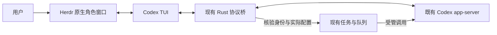

# Python / Rust 工作流对照与 Herdr 实机验证

> 2026-10-27 当前实现状态：基础 PR #142/#144（含 #145）已合入 main。首版独立恢复诊断入口与固定 600 秒语义修正见[恢复说明](../recovery-agent.md)；自动运维修复、人工写入权交接和多阶段发布仍待完成。下方内容保留为当时的方案、评估与验证历史。

> **2026-10-27 流程确认补充（优先适用）：** 后续流程已按[方案顶部](agent-reliability-proposal.md)和[四个跟踪 Issue](README.md)确认，包含独立恢复 Agent、发布角色、多 PR 与人工交接；不再处于等待确认方向的状态。这些能力尚未实现。原生 TUI 的当前范围见[接入配置与最终证据](../native-tui.md)，下文早期验证、失败及当时的未完成状态完整保留，不追认为新流程通过。

> **2026-10-27 接入完成更新（优先适用）：** 已在独立任务 runtime 中接回 Herdr 原生 Codex TUI，最新真实验收 25.25 秒通过。验证了同一任务会话的原生输入、队列工具、关闭重开、上下文连续性和终态回收；没有新增共享输入历史或修改 Codex 全局配置。实现位于 `/mnt/dev-ssd/herdr-flow-worktrees/native-tui-attachment`，分支 `fix/native-tui-attachment`；配置和证据见该工作树的 `references/native-tui.md`。旧入口、旧 watcher 和旧队列未切换。长任务、网络恢复、人工写入权交接及整个业务闭环仍另行讨论，不因本次 TUI 通过而补计完成。下方基础验证及失败历史保留。

日期：2026-10-27。状态：原生窗口的基础交互验证通过，完整任务接入未通过。
本文补充[调研备忘](agent-reliability-research.md)和[方案草案](agent-reliability-proposal.md)，
并取代此前“优先开发自制交互面板”的建议。历史失败记录保留，不追认通过。

## 结论与职责

Python 原项目已经用 Herdr 承载原生 Codex TUI，由协议桥核验会话、工作目录和模型，
通过 app-server 提交任务。Rust 已经移植这条路径。问题主要在后续新增任务 runtime
走了另一条后台 receiver 路径，未与可见窗口重新衔接；无需为语言迁移再造交互界面。

本次沿原路径实测通过：显示原会话、通过 Herdr 输入、收到同会话回复、关闭测试
窗口后重新打开并保留上下文。成功验证只覆盖一个只读测试会话，没有启动任务队列，
不能替代新增隔离任务的协调／开发／评审全流程验收。

职责应保持为：

| 组件 | 职责 |
| --- | --- |
| 既有 Codex | 登录、provider、订阅、计费、代理、模型执行与原生交互 |
| Herdr | 角色窗口、原生 Agent 前端、查看与终端输入 |
| herdr-flow | 角色模型选择、任务与队列、身份绑定、独立验收、交付及任务资源回收 |

恢复原流程不表示撤销已完成的角色模型配置、任务隔离、评审快照或明确回收。
Python 版也没有完成当前全部回收和人工接管要求，不能把它作为所有新验收项都已
满足的证据。OpenCode 保持不支持；不改变既有认证、计费、代理和用户共享配置。

## 对照来源与偏离位置

通过 GitHub 连接器读取用户指定的 [Python 仓库](https://github.com/musutrade/herdr-issue-flow)，
核对其 `SKILL.md`、`scripts/herdr_control.py`、`scripts/codex_tui.py` 和
`references/architecture.md` 的 Git blob，与本地 `/home/gem/herdr-issue-flow`
提交 `0d7253a60310ed562d68338c2439836f86ea3b45` 的对应文件完全相同。
Herdr 操作语法以本机 `herdr --skill` 和 CLI help 为准。

Rust 审计基线仍为 `e036bfc2fec0ce8040b794d8bfa2ff8f1d745d68`，不是当前 main。

| Python 的实际做法 | Rust 已有对应实现 | 本次判断 |
| --- | --- | --- |
| `herdr_control.py` 校验 pane、terminal、进程和协议身份 | `src/herdr.rs` | 应复用，不能只靠 Herdr idle 或屏幕文字确认任务身份 |
| `codex_tui.py` 启动原生 TUI，透明转发协议并记录匹配响应 | `src/codex/tui.rs`、`herdr-flow tui` | 原生窗口能力已经移植；本次实际运行该 Rust 桥 |
| `codex_rpc.py` 调用既有本地服务 | `src/codex/rpc.rs` | 继续复用上游登录，无需复制令牌 |
| `context_guard.py` 管理已登记会话及安全换班 | `src/guard/` | 保留原有边界；换班是明确的新会话，人工介入则须绑定当前原会话 |
| `wait_queue.py` / `task_progress.py` 持久化等待、ACK、应用与后继 | `src/queue/`、`src/progress.rs` | 继续作为任务事实来源，不为界面增加第二套队列 |
| `task_runtime.py` 主要检查接收者就绪条件 | `src/task_runtime/` 后来扩展出执行、后台 receiver 和回收 | 扩展能力须重新接回原生窗口，不能以后台测试替代可见验收 |

可定位的历史变化：

- 初次 Rust 移植提交 `1ce8b3d` 已包含原生 Herdr/TUI 路径。
- `5fa1aa2` 将文档中的 Herdr 定位改为可选适配。
- `df07e28` 激活独立任务 receiver；当前 `receiver_factory` 对任务专属 receiver
  优先选择 `native::receiver::active::Adapter`，不经过 Herdr 适配分支。
- 近期方案又把自制面板列为首选，进一步增加了不必要的改造范围；本轮已纠正。

本机安装的 `herdr-issue-flow` skill 链接到 main 工作树，与上述开发分支的当前
支持说明并不一致。本轮不切换全局入口，也不修改旧 watcher 或旧队列。

## 原有操作路径

Herdr skill 的普通用法是 `pane split` → `agent start` → `agent get/read/prompt`。
Python 受管流程为了取得协议身份，改由 `pane run` 启动 TUI 桥，再通过 Agent
接口操作其中被识别的原生 Codex。这是原项目已有的桥接方式。

自动派发继续用真实 thread/turn ID，不把终端接纳当作任务完成。
人工输入与自动写入的交接仍需补齐，图中两条调用路径并不意味着可以同时派发。

## 实机结果及范围

环境：Herdr client 0.9.5 / server 0.9.4，协议兼容；Codex CLI 和现有 daemon
均为 0.164.0。`daemon version` 返回的 socket 是已验证规范路径的软链接，两者
指向同一个服务，未切换服务、账号或计费路径。

成功记录位于 `/mnt/dev-ssd/dev-tmp/herdr-interaction-probe-20261027-11-native-skill/`：

| 检查 | 结果 |
| --- | --- |
| 原生窗口 | 使用未改动的 Rust `herdr-flow tui`，Herdr 识别为 Codex Agent |
| 原会话 | 两次窗口启动的协议桥均返回同一 thread；没有 fork 或创建替代会话 |
| 模型与工作目录 | `gpt-6.1-sol` / high、原工作目录及 read-only 沙箱保持一致 |
| 真实输入和显示 | 两次 `herdr agent prompt` 各产生一条对应 turn，原生屏幕显示实际回复 |
| 重开 | 关闭第一个测试 pane 后，在第二个 pane 恢复同一会话并记住先前测试短语 |
| 配置 | Codex 配置文件前后 SHA-256 相同；没有登录、信任确认、代理修改或服务重启 |
| 任务会话数据 | `thread/delete` 后，活动／归档列表无该 ID，rollout 已删除；历史投影表中按该 thread ID 查询为零行 |
| 窗口和临时根 | 测试 pane、桥进程与一次性根已回收；用户当前 pane 和真实会话保持不变 |
| 完整流程 | 未验证：三角色、动态队列工具、待人工请求回应、受控中断、控制权交还、长任务及故障恢复 |

身份核验还揭示一个区别：两个原生测试 pane 都被识别为 Codex，但 Herdr
`agent get` 的 `agent_session` 为 null；上述“同一会话”证据来自协议桥及实际
turn 历史。这与下文错误窗口收到会话引用的问题一致，不能宣称 Herdr 元数据绑定
已经完成。

这次成功验证在已有可信仓库只读运行，验证的是 Python 原路径的 Rust 对应能力。
独立任务 fixture 的接入被下面的信任／目录权限问题阻断，不能把这一成功结果
补计为独立队列验收通过。Python 客户端仅用作验证驱动，不是重新引入产品运行依赖。

### 失败记录

证据目录统一前缀为 `/mnt/dev-ssd/dev-tmp/herdr-interaction-probe-20261027-`。

| 记录 | 观察与处理 |
| --- | --- |
| `01` | 尚未形成 rollout 的新 thread 不能从第二连接 resume；保留失败，回收原任务 |
| `02`、`03` | 试验夹具误把静默命令结果／纯文本读取当 JSON；不是产品网络故障 |
| `04`、`05` | 自制面板试验的 turn completed，但未产生所需用户输入请求；不能判定交互通过，未证明根因 |
| `06-native` | 夹具在桥目录创建前读取；修正观测时序 |
| `07-native`、`08-native` | 原生 TUI 停在目录信任界面；后者保存了明确画面，没有点击会写入用户配置的确认 |
| `09-native` | 使用真实仓库的任务入场校验拒绝其 group-writable 祖先；尚未创建 runtime 或调用模型；未 chmod 用户目录 |
| `10-native-skill` | 首 turn 刚提交即读取磁盘历史，遇到 rollout 尚为空的观测竞态 |
| `11-native-skill` | 核对并继续 `10` 的原会话，没有重发种子任务；原生显示、输入、重开通过，然后回收 |

上述一次性测试根均已删除。失败保留在有界测试证据中；不是将运行目录改称“上游数据”。

最终补充盘点覆盖 9 个实际测试 thread 和 9 个测试 terminal：活动／归档会话清单
无这些 thread，测试 pane、记录的原生进程及全部测试根均已消失。共享历史和错误
引用单独记录，没有据此宣称零残留。盘点见
`herdr-interaction-probe-20261027-final-inventory.json`。

## 新发现与需要修正的边界

### 1. 会话引用被上报到错误窗口

共享 daemon 继承了 `HERDR_PANE_ID=wD:p1`，而本次测试窗口属于 `wJ`。
本机 Codex 的 Herdr SessionStart hook 从进程环境取得 pane ID，再将收到的新
session ID 上报给它；缺少“这个会话确实属于这个窗口”的连接身份核验。
实际 Herdr 保存状态的 `wD:p1` 因此出现测试会话引用，历史快照也有先前试验的引用。
用户当前 `wJ:p3` 的 live 会话仍与其 `CODEX_THREAD_ID` 一致。

在私有模拟 socket 上复现了这一路由：本机安装的 hook v8 和查阅的上游 v10
都把测试 ID 上报给 daemon 继承的窗口。测试没有连接真实 Herdr 服务，也没有
修改已安装 hook。因此不能把“升级一下 hook”当成已验证修复。

证据：`herdr-interaction-probe-20261027-hook-routing-audit.json`。
修正方向是按实际前端／协议桥的 pane、terminal、thread 绑定上报和撤销，禁止
后台共享 daemon 仅凭继承环境给另一个用户窗口更换会话。不得重启共享服务、
清除用户配置或直接改写全局 session 文件来绕过这项要求。

### 2. 新任务的目录信任与入场限制

新空仓库触发原生 Codex 的“信任此目录”提示，提示明确会保存决定。
这不是网络故障。上游源码已有真实 linked worktree 继承主仓库信任的逻辑；
应在受支持的任务 worktree 启动路径验证它，不另外管理认证或伪造 Git 归属。

但当前隔离入场拒绝本机真实开发目录的 group-writable 祖先，所以本轮没能
在该任务 fixture 内完成继承验证。后续须区分任务可写根的保护与既有源码仓库
的使用边界，提出有证据的适配；不能擅自修改用户目录权限来使测试通过。

### 3. 小型历史记录不等于工作区文件副本

用户询问后实测：

| 位置 | 文件总大小 | 本次命中内容 |
| --- | --- | --- |
| `~/.codex/history.jsonl` | 4,174,063 字节，约 3.98 MiB，包含原有历史 | 两条测试输入，共 386 字节；字段仅 `session_id`、`text`、`ts` |
| `~/.config/herdr/session.json` | 3,553 字节，约 3.47 KiB | 一个约 106 字节的会话引用；关联 pane 的记录只有 cwd 和会话引用 |
| 命中的 Herdr 历史快照 | 3,553 字节 | 先前测试 ID 的同类恢复引用 |

这些命中项没有复制临时工作区源码、构建产物或完整会话。两条输入是本次测试
的短提示，rollout 与临时工作目录已回收。共享数据库 WAL 的字节命中也不等于
仍有可用会话：本轮按精确 thread ID 查询四张历史表，未发现存活记录；没有
清空或重写共享数据库。

方案应分别定义任务执行资源回收和上游正常输入历史／恢复元数据的保留规则。
本次不以“上游数据”自动豁免未明确的回收要求，也不要求清空用户原有共享历史。
尤其错误窗口的恢复引用有实际归属风险，必须修正，不能仅以体积很小解释为正常。
本轮未修改这些共享文件，完整回收验收尚未通过。

## 建议开发顺序

1. **先修身份边界。** 解决共享 daemon 的 hook 错投、原生窗口与任务身份核验，
   明确窗口关闭／任务结束时如何撤销本任务引用。用私有模拟服务验证不影响其他
   pane，再做真实验证；不先切换全局 hook 或重启服务。
2. **接回现有原生路径。** 在独立任务创建的 worktree 中启动已有 Rust TUI 桥，
   贯通信任与目录入场，逐角色核验模型、目录、session 和原有 queue-control。
   协调、开发、评审都有可定位窗口，复用已有 guard / queue / task 状态。
3. **完成最小人工介入闭环。** 显示真实待人工请求，回应原请求，停止新自动派发，
   核验当前执行，再接管和交还；人工变更形成新候选并重新独立评审。原生终端
   可输入不能替代这些控制条件。
4. **按资源种类验收收尾。** 分别核验 worktree、进程、会话正文、队列、窗口与
   恢复引用；明确小型历史记录的保留范围及归属，不删用户共享资产。
5. **再落实长任务与恢复策略。** 在同一可见流程上分离通信期限、观察、业务期限
   和恢复预算，验证网络／Git 故障，避免另起后台调度系统或隐藏重跑。

首条纵向验收仍是“Herdr 找到原角色 → 人工介入 → 交还 → 独立评审 → 本地交付
→ 按契约回收”。没有完成这条链路前，不能解除完整接入的未完成状态。

本轮只交付对照、能力证据与方案修订。临时面板和验证用 broker 扩展不进入生产
实现，不提交／发布，也不修改全局入口、旧队列、已安装 hook、账号或代理。

临时实现已从试验工作树撤回，试验工作树与临时分支已回收，调试二进制重新构建
为原基线。仅保留约 43 KiB 的试验源补丁和上述验证证据，供复查失败及路线变化：
`/mnt/dev-ssd/dev-tmp/herdr-interaction-probe-20261027-abandoned-spike.patch`。
补丁已验证可应用到原基线，不作为待合入的产品实现。
